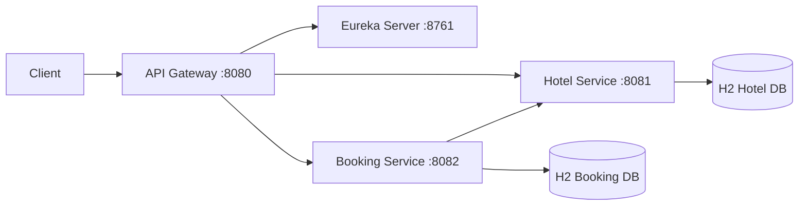
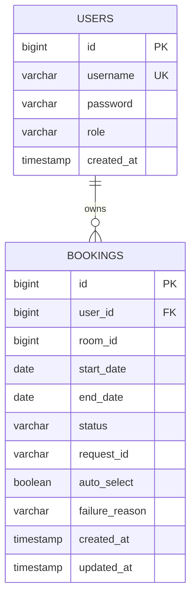
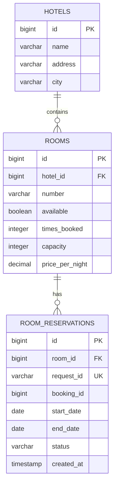

# Hotel Booking

Учебный микросервисный проект для бронирования отелей и номеров

Система состоит из Eureka Server, API Gateway, Hotel Service и Booking Service. Пользователь регистрируется или входит
по JWT, выбирает номер вручную или использует автоматический подбор. Booking Service координирует бронирование через
сагу с компенсацией

## Стек

- Java 21
- Spring Boot 3.5.6
- Spring Cloud 2025.0.2
- Spring Data JPA и H2
- Spring Security Resource Server и JWT HS256
- Spring Cloud Eureka
- Spring Cloud Gateway
- Resilience4j (Retry, CircuitBreaker)
- MapStruct и Lombok
- Springdoc OpenAPI
- JUnit, MockMvc, WebTestClient, WireMock
- Maven, Spotless (google-java-format)

## Структура проекта

```text
hotel-booking/
├── eureka-server/       # Service Registry, порт 8761
├── api-gateway/         # Gateway, порт 8080
├── hotel-service/       # Отели, номера и занятость, порт 8081
├── booking-service/     # Пользователи, JWT и бронирования, порт 8082
└── pom.xml
```

В микросервисах используются слои `entity`, `repository`, `dto`, `mapper`, `service`, `controller`, `config` и
`exception`. В Booking Service дополнительно есть пакет `client` для вызовов Hotel Service

## Возможности

- регистрация и вход пользователей
- JWT с ролями `USER` и `ADMIN`, срок действия токена 1 час
- CRUD отелей и номеров для администратора
- просмотр отелей и свободных номеров
- рекомендации номеров по `times_booked`, затем по `id`
- фильтры по отелю, датам, вместимости и цене
- создание бронирования вручную или через автоматический подбор
- состояния бронирования `PENDING`, `CONFIRMED`, `CANCELLED`
- идемпотентность клиентского запроса через `requestId`
- retry, timeout и circuit breaker при вызовах Hotel Service
- компенсация блокировки номера через `release`
- история только своих бронирований с пагинацией
- статистика загруженности номеров для администратора
- сквозной `X-Trace-Id` и MDC
- Swagger и единый формат ошибок `ErrorDto`

## Быстрый старт

Требования: Java 21 и Maven 3.9 или новее

Запустите приложения в следующем порядке:

```bash
mvn -pl eureka-server spring-boot:run
mvn -pl hotel-service spring-boot:run
mvn -pl booking-service spring-boot:run
mvn -pl api-gateway spring-boot:run
```

Регистрация сервисов в Eureka занимает до 30 секунд. Пока она не завершилась, запросы через Gateway могут возвращать
`503`

Сервисы:

| Компонент | Адрес |
|---|---|
| Eureka | http://localhost:8761 |
| API Gateway | http://localhost:8080 |
| Hotel Service | http://localhost:8081 |
| Booking Service | http://localhost:8082 |

Основные пользовательские запросы выполняются через Gateway

## Демо-данные

Booking Service создаёт при запуске:

| Пользователь | Пароль | Роль |
|---|---|---|
| admin | admin123 | ADMIN |
| ivan | user123 | USER |
| maria | user123 | USER |

Hotel Service содержит два отеля и шесть номеров с разными значениями `times_booked`. Номер 6 выведен из эксплуатации.
Также созданы две занятости для демонстрации фильтрации и статистики:

- номер 1: `today + 5` до `today + 8`
- номер 3: `today + 10` до `today + 12`

Они соответствуют двум подтверждённым броням из Booking Service

## API

### Аутентификация

| Метод | Endpoint | Доступ |
|---|---|---|
| POST | `/api/user/register` | открыт |
| POST | `/api/user/auth` | открыт |

### Пользователи

| Метод | Endpoint | Доступ |
|---|---|---|
| POST | `/api/user` | ADMIN |
| GET | `/api/user` | ADMIN |
| GET | `/api/user/{id}` | ADMIN |
| PATCH | `/api/user/{id}` | ADMIN |
| DELETE | `/api/user/{id}` | ADMIN |

### Бронирования

| Метод | Endpoint | Доступ |
|---|---|---|
| POST | `/api/bookings` | USER, ADMIN |
| GET | `/api/bookings` | USER, ADMIN (только свои бронирования) |
| GET | `/api/bookings/{id}` | владелец или ADMIN |
| DELETE | `/api/bookings/{id}` | владелец или ADMIN |

Параметры списка бронирований: `page`, `size`, `status`. Сортировка выполняется по `createdAt` от новых к старым

### Отели и номера

| Метод | Endpoint | Доступ |
|---|---|---|
| POST | `/api/hotels` | ADMIN |
| GET | `/api/hotels` | USER, ADMIN |
| GET | `/api/hotels/{id}` | USER, ADMIN |
| PUT | `/api/hotels/{id}` | ADMIN |
| DELETE | `/api/hotels/{id}` | ADMIN |
| POST | `/api/rooms` | ADMIN |
| GET | `/api/rooms` | USER, ADMIN |
| GET | `/api/rooms/recommend` | USER, ADMIN |
| GET | `/api/rooms/{id}` | USER, ADMIN |
| PUT | `/api/rooms/{id}` | ADMIN |
| DELETE | `/api/rooms/{id}` | ADMIN |
| GET | `/api/rooms/statistics` | ADMIN |

Параметры поиска номеров: `hotelId`, `startDate`, `endDate`, `minCapacity`, `maxPrice`

`/api/rooms/{id}/confirm-availability` и `/api/rooms/{id}/release` являются внутренними endpoint’ами Hotel Service.
Через Gateway они блокируются

## Примеры запросов

### Вход

```bash
curl -s -X POST http://localhost:8080/api/user/auth \
  -H 'Content-Type: application/json' \
  -d '{"username":"ivan","password":"user123"}'
```

Сохраните токен из ответа:

```bash
export USER_TOKEN='вставьте token из ответа'
```

Для администратора:

```bash
curl -s -X POST http://localhost:8080/api/user/auth \
  -H 'Content-Type: application/json' \
  -d '{"username":"admin","password":"admin123"}'
```

```bash
export ADMIN_TOKEN='вставьте token из ответа'
```

### Просмотр отелей и номеров

```bash
curl -i http://localhost:8080/api/hotels \
  -H "Authorization: Bearer $USER_TOKEN"

curl -i http://localhost:8080/api/rooms \
  -H "Authorization: Bearer $USER_TOKEN"

curl -i "http://localhost:8080/api/rooms/recommend?startDate=2030-01-10&endDate=2030-01-12" \
  -H "Authorization: Bearer $USER_TOKEN"
```

### Создание бронирования

Автоматический подбор:

```bash
curl -i -X POST http://localhost:8080/api/bookings \
  -H "Authorization: Bearer $USER_TOKEN" \
  -H 'Content-Type: application/json' \
  -H 'X-Trace-Id: demo-booking-001' \
  -d '{
    "requestId": "demo-request-001",
    "autoSelect": true,
    "startDate": "2030-01-10",
    "endDate": "2030-01-12"
  }'
```

Выбор конкретного номера:

```bash
curl -i -X POST http://localhost:8080/api/bookings \
  -H "Authorization: Bearer $USER_TOKEN" \
  -H 'Content-Type: application/json' \
  -d '{
    "requestId": "demo-request-002",
    "roomId": 2,
    "autoSelect": false,
    "startDate": "2030-02-10",
    "endDate": "2030-02-12"
  }'
```

Повтор того же запроса с тем же `requestId` возвращает существующее бронирование со статусом `200 OK` (новое
бронирование создаётся со статусом `201 Created`). Повтор с другими параметрами возвращает `409 Conflict`

### История и отмена

```bash
curl -i "http://localhost:8080/api/bookings?page=0&size=10" \
  -H "Authorization: Bearer $USER_TOKEN"

curl -i -X DELETE http://localhost:8080/api/bookings/1 \
  -H "Authorization: Bearer $USER_TOKEN"
```

### Административные операции

```bash
curl -i http://localhost:8080/api/user \
  -H "Authorization: Bearer $ADMIN_TOKEN"

curl -i "http://localhost:8080/api/rooms/statistics?from=2030-01-01&to=2030-01-31" \
  -H "Authorization: Bearer $ADMIN_TOKEN"
```

## Безопасность и ошибки

Gateway и каждый backend-сервис самостоятельно проверяют JWT. Для ролей используются полномочия `ROLE_USER` и
`ROLE_ADMIN`. Доступ к методам ограничен через `@PreAuthorize`

- `401 Unauthorized` возвращается при отсутствии или некорректном токене
- `403 Forbidden` возвращается при недостаточных правах
- `400 Bad Request` возвращается при ошибках валидации
- `404 Not Found` возвращается для отсутствующего ресурса
- `409 Conflict` возвращается при конфликте дат, номера или `requestId`
- `503 Service Unavailable` возвращается при недоступности Hotel Service

Ошибки имеют формат:

```json
{
  "timestamp": "2030-01-01T10:00:00Z",
  "status": 409,
  "error": "Conflict",
  "message": "No rooms are available for the requested dates",
  "path": "/api/bookings"
}
```

## Swagger и H2

Swagger:

- http://localhost:8081/swagger-ui.html
- http://localhost:8082/swagger-ui.html

H2 Console:

- Hotel Service: http://localhost:8081/h2-console, JDBC URL `jdbc:h2:mem:hoteldb`
- Booking Service: http://localhost:8082/h2-console, JDBC URL `jdbc:h2:mem:bookingdb`

Для обеих баз используются пользователь `sa` и пустой пароль

## Тестирование

Запустить все тесты:

```bash
mvn clean test
```

Запустить полную проверку с форматированием:

```bash
mvn clean verify
```

Форматирование кода выполняется командой `mvn spotless:apply`

Всего 84 теста: Gateway (5), Hotel Service (29), Booking Service (50). Проверяются CRUD, JWT и роли, валидация,
идемпотентность, сага, компенсация, retry, timeout, circuit breaker и конкурентные бронирования. Тесты не требуют
запущенных сервисов: Eureka в них отключена, Hotel Service заменяется заглушкой или WireMock

## Архитектура



Gateway выполняет маршрутизацию и первичную проверку JWT. Booking и Hotel дополнительно проверяют JWT самостоятельно.
Запросы Booking к Hotel передают Bearer token и `X-Trace-Id`

## Схема баз данных

### Booking Service



Для `bookings` используется уникальность `(user_id, request_id)` и индексы по `user_id`, `status`, `room_id`

### Hotel Service



`available` означает операционную доступность номера, например отсутствие ремонта. Занятость по датам определяется по
`room_reservations`. Дата `endDate` не включается в интервал. В `rooms` уникальна пара `(hotel_id, number)`, индексы
есть по `times_booked`, `city` отеля и по `(room_id, start_date, end_date)` в `room_reservations`

## ADR

### Saga вместо глобальной транзакции

Booking Service сначала фиксирует локальную запись `PENDING`, затем вызывает Hotel Service. При успехе запись становится
`CONFIRMED`. При ошибке выполняются `release` и переход в `CANCELLED`. Глобальные распределённые транзакции не
используются

### Идемпотентность через requestId

Клиент передаёт `requestId`. Уникальность `(user_id, request_id)` предотвращает дубликаты. Повтор с теми же параметрами
возвращает существующую бронь, а повтор с другими параметрами отклоняется с `409`

### Блокировка строки номера

Hotel Service сериализует конкурентные операции по номеру через `PESSIMISTIC_WRITE`. Фактическая блокировка дат хранится
в `room_reservations`, поэтому параллельные пересекающиеся бронирования не создают дубликаты

### Release без circuit breaker

Компенсация должна иметь возможность выполниться даже при открытом circuit breaker основного вызова. Поэтому `release`
использует отдельный retry и не использует circuit breaker

### Интервалы дат

`endDate` не включается. Бронь с 10 по 12 и бронь с 12 по 14 не пересекаются

### Общий HS256 секрет

Booking Service выдаёт JWT, а Gateway, Booking Service и Hotel Service проверяют его одним HS256 секретом. Это
соответствует учебной архитектуре проекта и упрощает проверку токена между сервисами

### Счётчик times_booked

При подтверждении бронирования `times_booked` увеличивается. При компенсации или отмене с успешным `release` счётчик
уменьшается. Рекомендации сортируются по этому счётчику и затем по идентификатору номера

### Ограничение компенсации

Если Hotel Service недоступен во время `release`, Booking Service сохраняет бронь в `CONFIRMED` при отмене уже
подтверждённой брони либо переводит создаваемую бронь в `CANCELLED`, но временная блокировка в Hotel может остаться до
ручного вмешательства

### Идентификатор запроса к Hotel Service

Клиентский `requestId` защищает от дублей в Booking Service. В Hotel Service уходит другой идентификатор,
`booking-<id брони>`: он глобально уникален (два пользователя могут прислать одинаковый клиентский `requestId`) и
стабилен для всех повторов одной брони. По нему Hotel Service определяет повторную доставку и освобождает блокировку

### Допустимые переходы статусов

`PENDING -> CONFIRMED`, `PENDING -> CANCELLED`, `CONFIRMED -> CANCELLED` (отмена пользователем или администратором).
`BookingStateService` проверяет эти переходы. Если после успешной блокировки номера локальное подтверждение не удалось,
Booking Service вызывает `release` и отменяет бронь

### Порядок фильтров в Gateway

Фильтр трассировки и блокировки внутренних путей реализован как `WebFilter` с наивысшим приоритетом. Он выполняется до
Spring Security, поэтому и ответы 401 и 403 содержат `X-Trace-Id`, а внутренние endpoint’ы Hotel Service блокируются (403) независимо от токена. Путь проверяется в декодированном виде. Фильтры трассировки Booking и Hotel также стоят перед
Security
